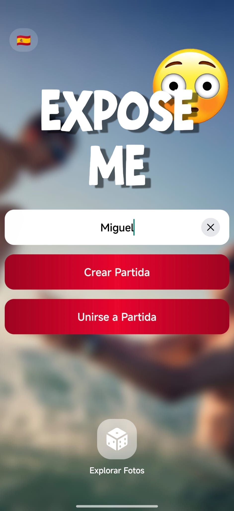
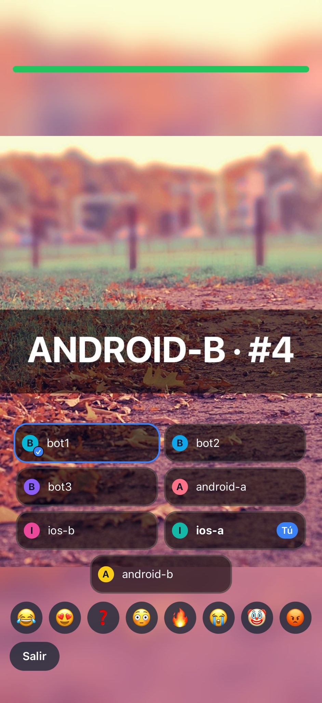

# Expose Me 📸

Expose Me is a mobile game that shows random photos and challenges players to guess who they belong to.

## Game modes

- **Explore Photos (solo)**: the app pulls random photos from your own gallery.
- **Multiplayer**: each round shows a random photo pulled from one of the players' galleries, and the rest of the group votes on whose photo it is.

## Features

- Room-code based session creation and joining (Create Game / Join Game)
- Multiplayer mode with per-round voting
- In-game chat
- Reactions to photos and votes
- Language selector

## Screenshots

  
  
  

## Status

Production access granted, pending store submission.
